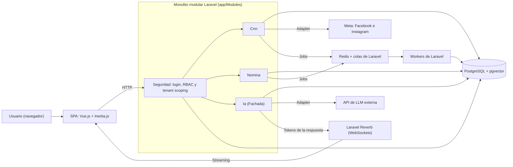

  

Plataforma Web SaaS Multi-Inquilino para la Gestión Integral de CRM, Automatización de Pre-Nómina y Asistente Empresarial Basado en Inteligencia Artificial con Gobernanza de Datos.

**Fecha de emisión:** 8 sept 2026

**Tipo de documento:** Propuesta de Proyecto

**Versión:** 1.0

## Integrantes del Equipo

- **Líder:** Juan Ángel Castañeda Chávez
- **Miembro:** Luis Fernando Robles Ibarra
- **Miembro:** José Eduardo Villarreal Pérez
- **Miembro:** Yahir Álvarez Amaya
- **Miembro:** Aziel Atlai Ochoa Alvarado

## 1. INTRODUCCIÓN

En el contexto empresarial contemporáneo, la eficiencia operativa de las organizaciones depende en gran medida de su capacidad para centralizar procesos clave: la prospección y atención a clientes (CRM) vinculada a canales digitales, y la administración del talento humano junto con el cálculo de nómina. Este anteproyecto plantea el diseño y desarrollo de una plataforma web unificada basada en arquitectura Software as a Service (SaaS) que integra estas áreas e incorpora un asistente conversacional inteligente capaz de realizar consultas analíticas instantáneas bajo estrictos protocolos de confidencialidad y aislamiento de datos multi-empresa.

## 2. PLANTEAMIENTO DEL PROBLEMA (PROBLEMÁTICA)

Actualmente, las microempresas y empresas pequeñas enfrentan un reto crítico: la dispersión y fragmentación de su información operativa:

Actualmente, muchas micro y pequeñas empresas manejan la información de sus clientes, empleados como hojas de cálculo y campañas publicitarias en diferentes herramientas o redes sociales. Esto hace que los datos estén separados, sean difíciles de consultar y puedan perderse o quedar desactualizados.

En el área de CRM, la falta de centralización ocasiona pérdidas de tiempo y recursos, ya que los encargados necesitan acceder a distintas cuentas para consultar la información. Cuando no cuentan con los accesos necesarios, se retrasa la elaboración de reportes y el seguimiento de las métricas que se comparten con los clientes. En el área de nómina, la falta de un control preciso de los horarios, asistencias y retardos dificulta la elaboración de la pre-nómina, lo que puede generar errores y afectar económicamente a los trabajadores.

En el área de ventas, no siempre existe un seguimiento adecuado de las personas interesadas que llegan desde Facebook o Instagram. Por otro lado, el registro de asistencias, retardos, faltas y horas extra suele realizarse manualmente, lo que aumenta el tiempo necesario para preparar la pre-nómina y puede provocar errores en los cálculos.

Por ello, se propone desarrollar una plataforma que reúna la gestión de clientes, campañas, empleados, asistencias y pre-nóminas en un solo lugar. También contará con un asistente de inteligencia artificial que permitirá consultar la información de manera sencilla, respetando los permisos de cada usuario y manteniendo separados los datos de cada empresa.

## 3. JUSTIFICACIÓN

El desarrollo de esta plataforma se justifica por las siguientes razones:

- **Centralización y Ahorro Operativo:** Unificar en un solo sistema la captación comercial y la gestión de nómina elimina la redundancia de datos, reduce los costos de licenciamiento de múltiples softwares y optimiza los tiempos de procesamiento administrativo hasta en un 60%.
- **Automatización Precisa:** La pre-nómina generada a partir de los registros directos de asistencia minimiza disputas laborales y errores de cálculo en percepciones y deducciones.
- **Democratización de la Información con IA Segura:** La integración de Inteligencia Artificial permite a los usuarios interactuar en lenguaje natural con su información empresarial. La implementación de filtros de inquilino y control de roles garantiza que un colaborador solo obtenga las respuestas para las que tiene autorización expresa, protegiendo secretos comerciales y datos personales.
- **Viabilidad y Rendimiento Tecnológico:** La adopción de un framework de desarrollo web garantiza un desarrollo robusto, seguro, con arquitectura probada, soporte nativo para colas de trabajo en segundo plano y una experiencia de usuario interactiva y fluida.

## 4. OBJETIVOS

### 4.1 Objetivo General

Desarrollar una plataforma web integral bajo el modelo SaaS, que centralice la administración de clientes (CRM), sincronización de campañas en redes sociales (Facebook e Instagram) y el control de personal/pre-nóminas, integrando un asistente conversacional con Inteligencia Artificial seguro que responda consultas contextuales en tiempo real garantizando el aislamiento estricto de los datos entre diferentes empresas y usuarios.

### 4.2 Objetivos Específicos

- **Módulo CRM y Conectividad Social:** Desarrollar un ecosistema centralizado para la gestión de relaciones comerciales que integre la captura automatizada de leads desde redes sociales, incluyendo herramientas para su calificación, priorización y segmentación. Este módulo permitirá un seguimiento estructurado del embudo de ventas, eliminando la dispersión de información y optimizando la tasa de conversión comercial.
- **Módulo de Nómina y Control de Asistencias:** Implementar el registro de empleados, control de asistencias/incidencias y el motor de cálculo automático de pre-nóminas con exportación de reportes detallados.
- **Mecanismo de IA y Consulta Contextual (RAG):** Integrar un modelo de lenguaje (LLM) a través de la página web conectada a una base vectorial para realizar consultas analíticas contextualizadas a los datos de la plataforma.
- **Seguridad Multi-Inquilino y Control de Acceso (RBAC):** Se va a implementar una metodología estricta de datos por empresa y niveles de autorización por rol, impidiendo filtraciones de datos dentro del chat y en los módulos web.
- **Interfaz de Usuario Reactiva y Streaming:** Desarrollar una interfaz moderna y responsiva y web, que incluya comunicación en tiempo real para el streaming de respuestas del chat con IA.

## 5. ALCANCE

- Se creará una plataforma web donde una empresa pueda manejar en un solo lugar la información de sus clientes, sus empleados y su nómina.
- Se espera **optimizar el área de ventas/CRM**, reuniendo en un solo lugar a los clientes o interesados que llegan desde Facebook e Instagram, para darles seguimiento sin tener que revisar varias cuentas por separado.
- Se espera **mejorar el proceso de nómina**, llevando un mejor control de las asistencias, retardos y faltas de los empleados, para que el cálculo de la pre-nómina sea más rápido y con menos errores.
- Se incluirá un **asistente de inteligencia artificial** dentro de la plataforma, que permita a los usuarios hacer preguntas sobre su información (clientes, ventas, empleados) y obtener respuestas de forma más rápida, sin tener que buscar manualmente en reportes o tablas.
- La información de cada empresa que use la plataforma estará separada y protegida, de manera que un usuario solo pueda ver los datos que le corresponden según su rol dentro de su empresa.
- La plataforma tendrá una interfaz sencilla y accesible desde el navegador, pensada para que sea fácil de usar sin necesitar conocimientos técnicos.

## 6. LIMITACIONES

- El proyecto no calculará la nómina final con todos sus impuestos y descuentos legales; sólo se generará una pre-nómina como apoyo para ese cálculo (no se timbrar ante el SAT).
- No se integrará con redes sociales distintas a Facebook e Instagram.
- La versión inicial del sistema permitirá vincular un máximo de 10 cuentas de Facebook e Instagram por empresa. La distribución de este límite entre ambas plataformas se definirá durante el desarrollo del MVP de acuerdo con las necesidades del proyecto. La ampliación de este límite mediante diferentes planes se contempla como una funcionalidad futura y no formará parte de la primera versión.
- No se desarrollará una aplicación para celular; la plataforma solo funcionará desde el navegador (web).
- El proyecto se limitará a las funciones definidas en este documento; cualquier función adicional que se pida más adelante se considerará un cambio fuera del alcance original.
- La plataforma necesita conexión a internet para funcionar, ya que depende de servicios externos (como Facebook/Instagram y el servicio de inteligencia artificial).
- No se dará mantenimiento ni soporte técnico después de la entrega final del proyecto, a menos que se acuerde algo distinto.

- La importación de información desde otros sistemas se limita al alta de empleados mediante archivo CSV con el formato definido por NexusERP; no se migrarán automáticamente otros datos históricos (como historial de asistencias pasadas, nómina de periodos anteriores, o leads/clientes ya existentes en otros CRMs)

## 6. Análisis de riesgo

Para saber qué tan complicado puede ponerse el proyecto, se evalúa cada riesgo con números del 1 al 5:

- **Probabilidad**: qué tan posible es que ese problema realmente pase.
- **Impacto**: qué tan grave sería para el proyecto si pasa.

Se multiplican ambos números y el resultado nos dice el nivel de riesgo:

| **Puntaje** | **Nivel** |
|-------------|-----------|
| 1 – 10      | Bajo      |
| 11 – 15     | Medio     |
| 16 – 20     | Alto      |
| 21 – 25     | Crítico   |

### 6.1 Matriz de probabilidad e impacto

| **Impacto \\ Probabilidad** | **1** | **2** | **3** | **4** | **5** |
|-----------------------------|-------|-------|-------|-------|-------|
| **5**                       | 5     | 10    | 15    | 20    | 25    |
| **4**                       | 4     | 8     | 12    | 16    | 20    |
| **3**                       | 3     | 6     | 9     | 12    | 15    |
| **2**                       | 2     | 4     | 6     | 8     | 10    |
| **1**                       | 1     | 2     | 3     | 4     | 5     |

### 6.2 Riesgos identificados

| **\#** | **Riesgo**                                                                                                                                                    | **Prob.** | **Impacto** | **Puntaje** | **Nivel** |
|--------|---------------------------------------------------------------------------------------------------------------------------------------------------------------|-----------|-------------|-------------|-----------|
| 1      | Que el cliente pida cambios pequeños durante el proyecto (colores, textos, ajustes de pantalla)                                                               | 5         | 2           | 10          | Bajo      |
| 2      | Que se tenga que cambiar cómo está organizada la información guardada, ya avanzado el proyecto                                                                | 3         | 5           | 15          | Medio     |
| 3      | Que pidan agregar funciones nuevas que no estaban contempladas al inicio                                                                                      | 4         | 4           | 16          | Alto      |
| 4      | Que se retrase la entrega de una parte del proyecto por carga de trabajo de la escuela                                                                        | 4         | 3           | 12          | Medio     |
| 5      | Que algún integrante del equipo no pueda seguir participando (se enferme, se dé de baja, etc.)                                                                | 3         | 4           | 12          | Medio     |
| 6      | Que Facebook o Instagram cambien su forma de conectar con otras plataformas y deje de funcionar la sincronización                                             | 3         | 4           | 12          | Medio     |
| 7      | Filtrado de información sensible de los clientes                                                                                                              | 5         | 5           | 25          | Crítico   |
| 8      | Que alguien vulnere la seguridad y accede a datos sensibles                                                                                                   | 5         | 5           | 25          | Crítico   |
| 9      | Las políticas de la API de IA cambie los costos de uso                                                                                                        | 3         | 3           | 9           | Bajo      |
| 10     | Que la pre-nómina se calcule mal por un error en el sistema                                                                                                   | 3         | 5           | 15          | Medio     |
| 11     | Que a los usuarios finales tengan resistencia al cambio                                                                                                       | 3         | 3           | 9           | Bajo      |
| 12     | La elección de arquitectura no de abasto al consumo de la aplicación (pendiente) Si el éxito incrementa, la escala estimada llegue a quedar corta (pendiente) | 3         | 3           | 9           | Bajo      |
| 13     | Pérdida de datos por mala gestión de respaldos                                                                                                                | 3         | 5           | 15          | Medio     |
| 14     | Que la documentación no sea adecuada para el usuario final                                                                                                    | 3         | 2           | 6           | Bajo      |
| 15     | Que no se cumpla con las reglas de protección de datos personales                                                                                             | 4         | 4           | 16          | Alto      |

## 7. ARQUITECTURA Y PATRONES DE DISEÑO

### 7.1 Arquitectura cliente-servidor

La plataforma se basa en una arquitectura cliente-servidor: el **cliente** es la interfaz que el usuario ve y utiliza desde su navegador, mientras que el **servidor** concentra la lógica de negocio y el acceso a la base de datos. A partir de esta base, se definieron dos decisiones principales: cómo organizar el servidor y cómo construir la interfaz del cliente.

### 7.2 Organización del servidor: monolito modular

Se optó por un **monolito modular**, es decir, un solo sistema backend organizado internamente por módulos con responsabilidades claras (CRM, Nómina, IA, Autenticación y Seguridad), en lugar de dividir el proyecto en microservicios independientes.

Esta decisión se tomó considerando lo siguiente:

- El equipo está conformado por 5 integrantes y el proyecto se desarrolla en 5 sprints:

  - Sprint 1: Arquitectura base y RBAC
  - Sprint 2: CRM y sincronización social
  - Sprint 3: Nómina y pre-nómina
  - Sprint 4: Asistente de IA
  - Sprint 5: Interfaz reactiva y streaming
  - Una arquitectura de microservicios añadiría una complejidad de comunicación y coordinación entre servicios que no es necesaria en esta etapa del proyecto.

- Organizar el sistema por módulos permite que cada integrante trabaje en su área asignada con poca dependencia del resto, sin perder orden ni claridad en el código.

- Si en el futuro la plataforma requiere crecer o escalar, un monolito modular facilita separar sus módulos en servicios independientes más adelante, sin tener que rediseñar el sistema desde cero.

### 7.3 Tipo de interfaz: aplicación de una sola página (SPA)

La interfaz del cliente se desarrollará como una **SPA (Single Page Application)**, en lugar de una página web tradicional que recarga por completo en cada acción del usuario.

Esta elección responde a los propios objetivos planteados en el documento:

- El proyecto contempla una interfaz reactiva y respuestas del asistente de IA en tiempo real (streaming), lo cual requiere que el contenido se actualice de forma dinámica sin recargar la página.

- Los módulos de CRM y Nómina incluyen tablas, filtros y paneles que se visualizan mejor con una interfaz que responde de inmediato a la interacción del usuario.

- La SPA se comunicará con el servidor a través de una API, obteniendo la información necesaria para cada módulo y para el chat con el asistente de IA.

### 7.4 Patrones de diseño a emplear

Para mantener el sistema ordenado, seguro y fácil de mantener conforme crezca, se aplicarán los siguientes patrones de diseño:

| **Patrón**                                                | **Propósito dentro del proyecto**                                                                                                                                                |
|-----------------------------------------------------------|----------------------------------------------------------------------------------------------------------------------------------------------------------------------------------|
| Aislamiento por empresa (tenant scoping)                  | Garantizar que la información de cada empresa se mantenga separada, de modo que ninguna pueda ver los datos de otra.                                                             |
| Middleware de validación                                  | Verificar, antes de procesar cualquier solicitud, que el usuario esté autenticado, pertenezca a la empresa correspondiente y cuente con el permiso necesario.                    |
| Repositorio (Repository)                                  | Separar la forma en que se almacenan los datos de la lógica de negocio, facilitando el mantenimiento de los módulos de CRM, Nómina y del historial del chat.                     |
| Estrategia (Strategy)                                     | Permitir manejar de forma ordenada distintas reglas de cálculo, como las variantes para determinar horas extra o retardos en la pre-nómina.                                      |
| Adaptador (Adapter)                                       | Facilitar la conexión con servicios externos (Facebook, Instagram y el proveedor del modelo de IA), de modo que un cambio en dichos servicios no afecte el resto del sistema.    |
| Fachada (Facade)                                          | Ofrecer al asistente de IA un único punto de acceso simplificado a la información de los distintos módulos, sin que necesite conocer su funcionamiento interno.                  |
| Procesamiento en segundo plano (colas de trabajo)         | Ejecutar tareas que no requieren respuesta inmediata, como el cálculo completo de una pre-nómina o el procesamiento de nuevos leads, sin interrumpir la experiencia del usuario. |
| Organización por capas (Controlador–Servicio–Repositorio) | Mantener cada módulo del backend estructurado internamente, separando la recepción de solicitudes, la lógica de negocio y el acceso a los datos.                                 |

### 7.5 Diagrama de arquitectura

El sistema es un monolito modular en Laravel con una SPA en Vue.js + Inertia.js como cliente. El módulo de Seguridad valida autenticación, empresa (tenant) y permisos antes de que cualquier solicitud llegue a los demás módulos. Las tareas pesadas se ejecutan en segundo plano mediante colas, y las respuestas del chat de IA se envían en streaming por WebSockets.

## 7. REQUISITOS FUNCIONALES Y NO FUNCIONALES

### 7.1 Requisitos funcionales

Requisitos numerados y agrupados por módulo, redactados como historias de usuario con su criterio de aceptación.

| **ID** | **Historia de usuario**                                                                                                                                                                                                                 | **Criterio de aceptación**                                                                                                                                                                                                                               |
|--------|-----------------------------------------------------------------------------------------------------------------------------------------------------------------------------------------------------------------------------------------|----------------------------------------------------------------------------------------------------------------------------------------------------------------------------------------------------------------------------------------------------------|
| RF-01  | Como encargado de ventas, quiero que los leads generados desde los formularios de Facebook e Instagram vinculados a la empresa entren automáticamente al CRM, para poder darles seguimiento sin consultar cada plataforma por separado. | Cuando se genera un nuevo lead en un formulario conectado, NexusERP lo registra automáticamente en el CRM con su origen identificado.                                                                                                                    |
| RF-02  | Como encargado de ventas, quiero calificar y priorizar leads, para dar seguimiento a los más valiosos primero.                                                                                                                          | Se puede asignar etiqueta/puntaje y filtrar la tabla por ese criterio.                                                                                                                                                                                   |
| RF-03  | Como encargado de ventas, quiero ver el embudo de ventas por etapas, para saber en qué punto está cada cliente.                                                                                                                         | Cada lead muestra una etapa (nuevo, contactado, negociación, cerrado) editable.                                                                                                                                                                          |
| RF-04  | Como administrador, quiero registrar empleados y sus datos laborales, para tener un registro centralizado en los empleados.                                                                                                             | Se puede dar de alta/editar/baja un empleado con sus datos obligatorios.                                                                                                                                                                                 |
| RF-05  | Como encargado de RH, quiero registrar asistencias, retardos y faltas, para llevar el control diario.                                                                                                                                   | Cada registro queda ligado a fecha y empleado; se pueden corregir con bitácora de cambios.                                                                                                                                                               |
| RF-06  | Como encargado de RH, quiero que el sistema calcule la pre-nómina automáticamente, para reducir errores manuales.                                                                                                                       | El sistema genera el cálculo de percepciones/deducciones a partir de asistencias, exportable en reporte.                                                                                                                                                 |
| RF-07  | Como usuario autorizado, quiero preguntarle al asistente de IA sobre mis datos (clientes, ventas, empleados), para obtener respuestas sin buscar manualmente.                                                                           | El chat responde en streaming citando solo datos de la empresa y el rol del usuario.                                                                                                                                                                     |
| RF-08  | Como administrador, quiero que cada empresa vea solo su propia información, para garantizar confidencialidad.                                                                                                                           | Ninguna consulta (web o chat) devuelve datos de otra empresa aun manipulando parámetros.                                                                                                                                                                 |
| RF-09  | Como administrador, quiero asignar roles y permisos a los usuarios, para controlar qué módulos y datos puede ver cada quien.                                                                                                            | Un usuario sin permiso no puede ver ni el módulo ni la opción en el menú.                                                                                                                                                                                |
| RF-10  | Como usuario, quiero iniciar sesión y que la información filtre automáticamente los datos de mi empresa.                                                                                                                                | El login valida credenciales y limita el contexto de trabajo a una empresa a la vez.                                                                                                                                                                     |
| RF-11  | Quiero que el sistema muestre errores detallados y amigables que el usuario pueda entender.                                                                                                                                             | El sistema tendrá la capacidad de procesar los errores sin que se rompa el sistema cuando suceda.                                                                                                                                                        |
| RF-12  | Como administrador de una empresa, quiero vincular la cuenta de Meta de la organización con NexusERP, para permitir el acceso autorizado a los activos de Facebook e Instagram asociados.                                               | El sistema permite realizar el proceso de autorización con Meta y guardar la integración asociada exclusivamente a la empresa activa.                                                                                                                    |
| RF-13  | Como administrador, quiero visualizar y seleccionar las cuentas disponibles de Facebook e Instagram asociadas a la integración de Meta, para definir cuáles serán utilizadas dentro de NexusERP.                                        | Después de conectar Meta, el sistema muestra las cuentas disponibles y permite vincular o desvincular cuentas hasta alcanzar el límite máximo de 10 establecido para el MVP.                                                                             |
| RF-14  | Como usuario autorizado, quiero consultar las campañas publicitarias pertenecientes a las cuentas vinculadas, para conocer la actividad publicitaria de la empresa desde NexusERP.                                                      | El sistema muestra las campañas de las cuentas publicitarias vinculadas e identifica, como mínimo, su nombre, estado y cuenta publicitaria de origen.                                                                                                    |
| RF-15  | Como usuario autorizado, quiero consultar las estadísticas de las campañas publicitarias de Facebook e Instagram, para analizar su rendimiento sin ingresar directamente a Meta.                                                        | El sistema permite consultar métricas publicitarias como gasto, impresiones, alcance, clics, CTR, CPC, CPM, resultados y costo por resultado para un periodo determinado.                                                                                |
| RF-16  | Como usuario autorizado, quiero filtrar la información publicitaria por cuenta, campaña y rango de fechas, para analizar únicamente los datos relevantes para mi consulta.                                                              | El sistema permite aplicar filtros por cuenta publicitaria, campaña y rango de fechas, actualizando las métricas mostradas según los criterios seleccionados.                                                                                            |
| RF-17  | Como usuario autorizado, quiero visualizar de forma resumida las principales métricas publicitarias, para interpretar fácilmente el rendimiento de las campañas.                                                                        | El sistema presenta las principales métricas mediante indicadores, tablas y gráficas básicas. Los reportes avanzados y dashboards personalizables quedan fuera del MVP.                                                                                  |
| RF-18  | Como encargado de ventas, quiero identificar el origen de cada lead proveniente de Meta, para conocer desde qué cuenta, formulario o campaña fue generado.                                                                              | Cada lead recibido desde Meta almacena, cuando la información esté disponible, su plataforma de origen, formulario y referencia de campaña asociada.                                                                                                     |
| RF-19  | Se pandora importar empleados desde un archivo exportado de otro sistema, para dar de alta a mi personal sin tener que capturarlo uno por uno manualmente.                                                                              | El sistema permite subir un archivo en formato CSV con los datos de los empleados; NexusERP valida que el archivo tenga el formato esperado y da de alta a los empleados correctamente, mostrando un mensaje claro si algún registro no pudo importarse. |

### 7.2 Requisitos no funcionales

| **ID** | **Requisito**                            | **Métrica / criterio**                                                                                                         |
|--------|------------------------------------------|--------------------------------------------------------------------------------------------------------------------------------|
| RNF-01 | Seguridad y aislamiento de datos         | Todas las consultas filtradas por empresa_id; sin fugas entre inquilinos verificado con pruebas.                               |
| RNF-02 | Control de acceso basado en roles (RBAC) | Matriz de permisos documentada y probada por rol.                                                                              |
| RNF-03 | Rendimiento de la interfaz               | Respuesta de la SPA a acciones de usuario en menos de 2 s en condiciones normales.                                             |
| RNF-04 | Streaming de respuestas del chat IA      | El texto de la IA comienza a mostrarse en menos de 2 s tras enviar la pregunta.                                                |
| RNF-05 | Disponibilidad                           | Plataforma operativa durante el periodo de evaluación del proyecto (entorno de pruebas).                                       |
| RNF-06 | Usabilidad                               | Un usuario sin conocimientos técnicos completa el registro de una asistencia en menos de 3 pasos.                              |
| RNF-07 | Escalabilidad                            | El diseño (monolito modular) permite separar módulos en servicios independientes a futuro sin reescribir la lógica de negocio. |
| RNF-08 | Compatibilidad                           | Accesible desde navegadores modernos (Chrome, Edge, Firefox) en escritorio.                                                    |

## 8. DEFINICIÓN DE MVP (ALCANCE PRIORIZADO)

Con base en los requisitos anteriores, se prioriza el alcance en tres niveles, para tener claro qué se entrega primero y qué queda fuera de la primera versión funcional.

### 8.1 Funciones del MVP (imprescindibles)

- Registro/login de usuarios y selección de empresa (multi-tenant).
- Captura de leads desde Facebook e Instagram con etapa del embudo (RF-01 a RF-03).
- Alta de empleados y registro diario de asistencias/retardos/faltas (RF-04, RF-05).
- Cálculo automático de pre-nómina básica y su exportación (RF-06).
- Chat con IA que responde preguntas simples respetando el aislamiento por empresa y rol (RF-07, RF-08).
- Roles y permisos básicos: Administrador, Ventas, RH (RF-09).
- Integración con Meta para vincular hasta 10 cuentas de Facebook e Instagram por empresa, consultar sus campañas y visualizar métricas publicitarias básicas (RF-12 a RF-17).

### 8.2 Fase 2 (deseable, fuera del MVP)

- Segmentación avanzada y puntajes automáticos de leads.
- Reportes analíticos más elaborados y dashboards personalizables.
- Historial extendido de conversaciones de IA con búsqueda semántica avanzada.
- Notificaciones automáticas (correo/push) de vencimientos y pendientes.
- Sistema de planes para ampliar el número de cuentas de Facebook e Instagram vinculadas por empresa, permitiendo superar el límite inicial de 10 cuentas de acuerdo con las necesidades de cada cliente.

| Dimensión | Definición |
|---|---|
| Usuarios objetivo | Micro y pequeñas empresas con equipos de ventas y RH de hasta ~30 empleados. |
| Func • Sistema de planes para ampliar el número de cuentas de Facebook e Instagram vinculadas por empresa, permitiendo superar el límite inicial de 10 cuentas de acuerdo con las necesidades de cada cliente.iones incluidas | CRM básico, control de asistencias, pre-nómina y chat IA (ver 8.1). |
| Plazo | 5 sprints (ver cronograma, sección 11), entregando el MVP funcional al cierre del proyecto. |

## 9. ELECCIÓN DE METODOLOGÍA Y ROLES DEL EQUIPO

### 9.1 Metodología

Se elige Scrum adaptado al contexto académico: 5 integrantes y 5 sprints se alinean de forma natural con iteraciones cortas de una a dos semanas, con entregables demostrables al final de cada sprint. Permite reordenar prioridades entre sprint y sprint conforme surgen ajustes (ver sección de riesgos), y hace visible el avance real frente al profesor en cada revisión.

### 9.2 Roles del equipo

| **Integrante**                | **Rol en el proyecto**                     | **Responsabilidad principal**                                                                         |
|-------------------------------|--------------------------------------------|-------------------------------------------------------------------------------------------------------|
| Juan Ángel Castañeda Chávez   | Líder / Product Owner                      | Prioriza el backlog, es el punto de contacto con el profesor y valida los entregables de cada sprint. |
| Luis Fernando Robles Ibarra   | Desarrollador — Módulo CRM                 | Captura de leads, embudo de ventas e integración con Facebook/Instagram.                              |
| José Eduardo Villarreal Pérez | Desarrollador — Módulo Nómina              | Registro de asistencias y motor de cálculo de pre-nómina.                                             |
| Yahir Álvarez Amaya           | Desarrollador — IA/RAG y Seguridad         | Asistente conversacional, base vectorial y control multi-inquilino (RBAC).                            |
| Aziel Atlai Ochoa Alvarado    | Desarrollador — Frontend/UI y Scrum Master | Interfaz SPA, streaming del chat y facilita las ceremonias del equipo (planning, revisión, retro).    |

Esta asignación es una propuesta inicial; el equipo puede ajustarla según afinidad e ir rotando apoyos entre módulos si algún sprint lo requiere.

### 9.3 Plan de contingencia de roles

- Si un integrante deja de participar (riesgo \#5 de la matriz de riesgos), el líder reasigna sus tareas pendientes entre el resto del equipo, priorizando las funciones del MVP.
- Todo el conocimiento de cada módulo se documenta en el repositorio (README por módulo) para que cualquier integrante pueda darle continuidad.

## 10. SEPARACIÓN DEL PROYECTO EN TAREAS

Desglose de las funciones del MVP en tareas de desarrollo, con estimación en días-persona, dependencias y criterio de terminado (Definition of Done: código funcionando, probado manualmente y integrado a la rama principal).

| **Módulo** | **Tarea**                                                       | **Estimación** | **Depende de**               |
|------------|-----------------------------------------------------------------|----------------|------------------------------|
| Base       | Definir modelo de datos multi-tenant (empresa_id en cada tabla) | 3 días         | —                            |
| Base       | Login, sesión y selector de empresa                             | 3 días         | Modelo de datos              |
| Base       | Middleware de autenticación y RBAC (Chain of Responsibility)    | 3 días         | Login                        |
| CRM        | Conexión y captura de leads (Facebook/Instagram)                | 5 días         | Middleware RBAC              |
| CRM        | Tabla de leads con etapas del embudo y filtros                  | 3 días         | Captura de leads             |
| Nómina     | Alta de empleados y catálogo                                    | 2 días         | Middleware RBAC              |
| Nómina     | Registro diario de asistencias/retardos/faltas                  | 4 días         | Alta de empleados            |
| Nómina     | Motor de cálculo de pre-nómina + exportación                    | 5 días         | Registro de asistencias      |
| IA         | Ingesta de datos a base vectorial (RAG)                         | 4 días         | Modelo de datos              |
| IA         | Chat con streaming y filtros por rol/empresa                    | 5 días         | Ingesta RAG, Middleware RBAC |
| UI         | Interfaz SPA (dashboard, formularios, chat)                     | 6 días         | Endpoints de cada módulo     |
| Cierre     | Pruebas integrales y ajuste de errores                          | 3 días         | Todo lo anterior             |

## 11. CRONOGRAMA

Cinco sprints de dos semanas cada uno, con un hito demostrable al cierre de cada sprint.

| **Sprint** | **Semanas** | **Objetivo del sprint**                                      | **Entregable / hito**                                  | **Responsable principal** |
|------------|-------------|--------------------------------------------------------------|--------------------------------------------------------|---------------------------|
| Sprint 1   | 1-2         | Base del sistema: modelo de datos, login multi-tenant y RBAC | Login funcional con selección de empresa               | Líder + todo el equipo    |
| Sprint 2   | 3-4         | Módulo CRM: captura de leads y embudo de ventas              | Demo de leads entrando desde Facebook/Instagram        | Luis Fernando             |
| Sprint 3   | 5-6         | Módulo Nómina: asistencias y motor de pre-nómina             | Pre-nómina calculada de un periodo de prueba           | José Eduardo              |
| Sprint 4   | 7-8         | Asistente de IA: RAG y chat con streaming                    | Chat respondiendo preguntas reales con datos de prueba | Yahir                     |
| Sprint 5   | 9-10        | Integración de UI, pruebas y cierre del MVP                  | MVP integrado y probado, listo para entrega final      | Aziel + todo el equipo    |

## 12. ELECCIÓN DE ESTRUCTURA WEB Y TECNOLOGÍAS

Stack concreto, elegido para cubrir directamente los requisitos no funcionales de la sección 7.2 (seguridad multi-tenant, streaming del chat y colas de trabajo en segundo plano).

| **Capa**                          | **Tecnología elegida**                          | **Por qué**                                                                                                                                                                            |
|-----------------------------------|-------------------------------------------------|----------------------------------------------------------------------------------------------------------------------------------------------------------------------------------------|
| Backend                           | Laravel (PHP) — monolito modular                | Framework robusto y maduro, con soporte nativo para colas de trabajo en segundo plano (RNF-07) y autenticación/roles integrados, tal como se plantea en la justificación del proyecto. |
| Frontend                          | SPA con Vue.js + Inertia.js                     | Interfaz reactiva sin recargar la página, necesaria para el streaming del chat de IA (RNF-04) y para dashboards con filtros dinámicos.                                                 |
| Base de datos                     | PostgreSQL                                      | Motor relacional confiable, con soporte de la extensión pgvector para las consultas de IA (RAG) sin depender de un motor aparte.                                                       |
| Colas / trabajos en segundo plano | Redis + colas de Laravel                        | Procesar en segundo plano la captura de leads y el cálculo de pre-nómina sin bloquear al usuario (patrón Observer/colas, ya definido en patrones de diseño).                           |
| Tiempo real                       | Laravel Reverb (WebSockets)                     | Envío en streaming de las respuestas del chat de IA token a token (RNF-04).                                                                                                            |
| Motor de IA                       | API de un LLM externo + pgvector para RAG       | Permite consultas contextuales sin entrenar un modelo propio, controlando el aislamiento de datos por empresa en la propia consulta a la base vectorial (RF-08).                       |
| Hospedaje                         | Servidor único (VPS o PaaS tipo Railway/Render) | Suficiente para el alcance académico; la arquitectura modular permite escalar a servicios separados si el uso crece (RNF-07).                                                          |

## 13. WIREFRAMES

Bocetos de baja fidelidad de las seis pantallas principales, con orden lógico de navegación: iniciar sesión → elegir empresa → dashboard → módulos (CRM, asistencias, pre-nómina) → chat de IA. Consideraciones: en escritorio el menú lateral queda fijo; en móvil/tablet se colapsa a un menú superior tipo hamburguesa, manteniendo el mismo orden de navegación.

| **\#** | **Pantalla**                | **Elementos principales**                                                |
|--------|-----------------------------|--------------------------------------------------------------------------|
| 1      | Dashboard CRM               | KPIs de ventas, tabla de leads con filtros por etapa y origen (FB/IG).   |
| 2      | Ficha de cliente            | Datos de contacto, historial de interacciones, notas y siguiente acción. |
| 3      | Pre-nómina                  | Selector de periodo, tabla de cálculo por empleado, botón de exportar.   |
| 4      | Chat con IA                 | Historial de conversación con streaming, caja de texto para preguntas.   |
| 5      | Control de asistencias      | Tabla diaria por empleado con entrada/salida, retardos y horas extra.    |
| 6      | Login / selector de empresa | Credenciales y selección de la empresa activa (multi-tenant).            |

Link de visualización de los wireframes: [https://www.figma.com/design/Zilr8kG0HNsNOi57dSwjtS/NexusERP-2.0-%E2%80%94-Wireframes?node-id=0-1&t=6wpZr8AOAvs2AM2i-1](https://www.figma.com/design/Zilr8kG0HNsNOi57dSwjtS/NexusERP-2.0-%E2%80%94-Wireframes?node-id=0-1&t=6wpZr8AOAvs2AM2i-1)

### 13.1 Enlace del maquetado

El maquetado de la interfaz de NexusERP 2.0 puede consultarse en Figma mediante el siguiente enlace:

[Ver maquetado de NexusERP 2.0 en Figma](https://www.figma.com/design/Zilr8kG0HNsNOi57dSwjtS/NexusERP-2.0-%25E2%2580%2594-Wireframes?node-id=39-134&t=NytzZpvVxGgAMKm4-0)

## 14. DEFINICIÓN DE CONTENIDO (TEXTOS, IMÁGENES, ETC.)

| **Tipo de contenido**    | **Detalle**                                                                   | **Criterio de selección / licencia**                                                             |
|--------------------------|-------------------------------------------------------------------------------|--------------------------------------------------------------------------------------------------|
| Textos de interfaz       | Etiquetas de botones, mensajes de error/éxito, textos de ayuda en formularios | Tono cercano y claro, en español neutro, redactados por el propio equipo.                        |
| Copys informativos       | Descripciones cortas de cada módulo en el dashboard (onboarding)              | Mismo tono; revisados por el líder antes de integrarse.                                          |
| Logo e identidad visual  | Logotipo 'Nexus ERP', paleta de colores, ícono de la app                      | Diseño propio del equipo; sin uso de marcas de terceros.                                         |
| Iconografía              | Íconos de menú y acciones (usuarios, chat, reportes, etc.)                    | Librería de íconos open source (p. ej. Lucide o Heroicons), uso libre para proyectos académicos. |
| Tipografía               | Fuente principal de la interfaz                                               | Fuente con licencia abierta (Google Fonts), legible en pantalla.                                 |
| Imágenes / ilustraciones | Estados vacíos (sin leads, sin empleados) y pantalla de bienvenida            | Bancos de imágenes libres de derechos (unDraw, Storyset) citando la fuente.                      |
| Datos de prueba          | Empresas, empleados y leads ficticios para las demos de cada sprint           | Datos inventados por el equipo; ninguno corresponde a personas reales.                           |
